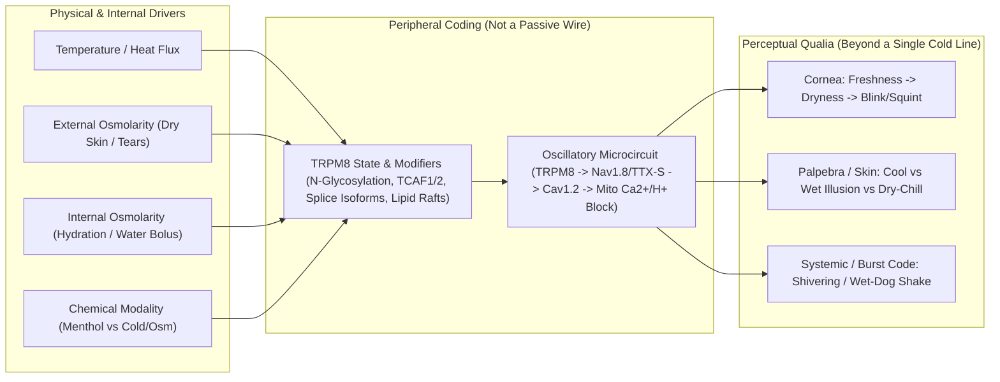

# Beyond the Cold Labeled Line: Tissue Osmolarity, Oscillatory TRPM8 Coupling, and Human Behavioral Falsifications (v2 — Integrated with Primary Lab Data)

> [!NOTE]
> **Sources & Licensing Notice:** This v2 blueprint integrates your primary recordings and drafts from Google Drive (`TRPM8 Oscillations/` — `24-Final-TRPM8.pptx`, `lets think about TRPM8...`, `There was a paper from belmonte...`) alongside open-access literature retrieved via **Europe PMC** (`literature-search-europepmc`). Please review the Europe PMC terms at https://europepmc.org/ and verify individual paper licenses before reuse. All Europe PMC URLs are listed in [Section 6](#6-verified-literature-sources).

---

## 1. Inventory of What Your Primary Data Already Established (Bench Foundation)

Before designing new tests, here is the exact mechanistic foundation **already proven** by your 2009–2011 Usachev Lab recordings (`24-Final-TRPM8.pptx`) and 2016 corneal blink assay ([Yorek MS et al., *IOVS* 2016](https://europepmc.org/article/PMC/PMC5113984)):

| Completed Finding | Experimental Evidence (Your Data) | Mechanistic Implication |
| :--- | :--- | :--- |
| **Physiological vs. Saturating TRPM8 Regimes Are Distinct** | **50 nM icilin** ($EC_{50} = 360\text{ nM}$) or mild cooling drives rhythmic, phase-locked **electrical bursts ($V_m \approx -45 \to -15\text{ mV}$) and $[\text{Ca}^{2+}]_i$ oscillations (~100–500 nM)** (Slides 15–18, 29), mimicking Gallar et al. (2003) static cold bursts. **1 µM icilin** produces a single uncoupled flood. | Standard high-dose agonist experiments miss the native oscillatory encoding regime entirely. |
| **TRPM8 Alone Is Not Sufficient** | **Overexpressing TRPM8 in large DRG neurons does NOT reconstitute oscillations** (Slide 20). | Directly refutes a channel-only model: the native **co-expressed channel complement / accessory machinery** is mandatory for pattern generation. |
| **Coupled $\text{Na}_\text{v}1.8$ + TTX-S $\text{Na}_\text{v}$ + L-type $\text{Ca}_\text{v}$ Loop** | At **50 nM icilin**, oscillations are abolished by **TTX**, **1 µM A-803467 ($\text{Na}_\text{v}1.8$)** (which hyperpolarizes the cell from ~−44 to −52 mV), and **1 µM nimodipine / isradipine (L-type $\text{Ca}_\text{v}$)**, and induced by **Bay K 8644**; **$\omega$-conotoxin (N-type)** has no effect. **1 µM icilin is unaffected** by all four blockers (Slides 21–29). | Notably, **$\text{Ca}_\text{v}1.3$ KO mice retain oscillations** (Slide 25), isolating **$\text{Ca}_\text{v}1.2$** (or $\text{Ca}_\text{v}1.2$ compensation) as the active L-type partner. |
| **Mitochondrial $\text{Ca}^{2+}$ → Intracellular $\text{H}^+$ Reset** | Simultaneous $[\text{Ca}^{2+}]_i$ + $\text{pH}_i$ (F480/440) imaging shows **phase-locked cytosolic acidification** at every 50 nM icilin $\text{Ca}^{2+}$ peak; **1 µM FCCP** collapses rhythmic oscillations into a flat plateau (Slide 34; Werth & Thayer 1994; Andersson et al. 2004; TMBIM5/LETM1 candidate on Slide 37). | Provides a concrete intracellular negative-feedback clock that closes cold/icilin-gated TRPM8—and uniquely **predicts a divergence from menthol**, which bypasses $\text{H}^+$ block! |
| **In Vivo Hyperosmolar TRPM8 Reflex** | Hyperosmolar eye drops (290–900 mOsm) drive dose-dependent, **BCTC-blocked** eyelid squinting in control rats, blunted in diabetic neuropathy ([Yorek MS et al. 2016](https://europepmc.org/article/PMC/PMC5113984)). | Confirms physiological TRPM8 osmosensation in vivo and establishes a simple behavioral readout. |

---

## 2. Core Thesis: Breaking "Pure Labeled Line" & "Pure Evaporative Cooling"

Standard sensory dogma rests on two simplifications:
1. **Pure Labeled Line (Müller's Law):** Exciting TRPM8 fibers simply triggers a scalar "cold" percept proportional to firing rate.
2. **Pure Evaporative Wetness:** Humans feel "wet" or "dry-cold" solely because water evaporation cools the skin (thermal TRPM8) plus tactile slip.

**Why both break down simultaneously:**
- **Icilin "Wet Dog Shakes" ([Selescu, Zimmermann, Babes et al. 2025](https://europepmc.org/article/PMC/PMC12830821)):** Non-evaporative TRPM8 activation with zero water and zero temperature drop triggers the full wetness-expulsion motor program in mammals and birds.
- **Cornea vs. Palpebra / Lid Margin vs. Skin:** Adjacent trigeminal ($V_1$) territories separated by millimeters share TRPM8 and identical evaporative physics, yet corneal TRPM8 firing produces **dryness / freshness / blink drive / grit**, whereas palpebral/cutaneous TRPM8 produces **cool / wet / chill-shiver**.
- **Warm Coding Already Broke Pure Labeled Lines:** [Paricio-Montesinos et al. (2020)](https://europepmc.org/article/PMC/PMC7272120) showed even *warmth* requires **TRPM8 silencing** combined with warm-fiber excitation (cross-fiber/combinatorial coding).
- **Your Drive Framework (`lets think about TRPM8...` + `belmonte_paper.md`):** TRPM8 gating free energy integrates thermal flux and transmembrane osmotic gradient ($\Delta G_{\text{osm}}(\Delta\text{Osm}_{\text{ext}} - \Delta\text{Osm}_{\text{int}})$), AND your Usachev-lab data show that the **oscillatory temporal burst code** depends on the cell's internal partner machinery ($\text{Na}_\text{v}1.8$, $\text{Ca}_\text{v}1.2$, mitochondrial $\text{H}^+$).

---

## 3. Phase 1 — Human-Behavior-First Popperian Falsification Suite (No Wet Lab Required)

Per your strategy (**human behaviors first → then channel modifications / accessory proteins → home physiology rig**), these **5 human behavioral experiments** directly target the "pure labeled line" and "pure evaporative cooling" hypotheses using accessible tools (smartphone app, sterile saline, occlusive film, menthol, consumer IR thermometer / phone thermal camera, optional inexpensive Peltier thermode later).

| ID | What It Tests | Human Behavioral Protocol | Prediction (Beyond Labeled Line / Evaporation) | Severe Falsification Criterion |
| :--- | :--- | :--- | :--- | :--- |
| **H1** | **Cornea vs. Palpebral Lid Margin vs. Eyelid Skin** *(Same $V_1$ Nerve, Divergent Qualia)* | Apply **isothermal (34 °C)** sterile hyperosmolar saline (300 vs. 450 vs. 600 mOsm) and **isothermal dry vs. humid air puffs (34 °C, 10% vs. 95% RH)** selectively to: (a) corneal surface, (b) inner palpebral lid margin, (c) outer eyelid skin. Score 5 independent qualia (`Cool`, `Wet`, `Dry/Gritty`, `Sting`, `Blink/Shudder urge`) + phone-camera blink rate. | Identical **non-cooling** hyperosmolar stimuli generate orthogonal qualia across adjacent $V_1$ zones (*dryness/blink* on cornea vs. *cool/wet* on lid margin vs. *cold-threshold shift* on skin) even at 34 °C with zero $\Delta T$. | If isothermal hyperosmolarity produces **zero** sensory difference across zones once surface IR temperature is matched (or only evokes identical "cool" scaling linearly with intensity), then tissue-specific TRPM8 tuning/coding is **falsified**. |
| **H2** | **Non-Evaporative Dryness & Osmotic Coldness** *(Paired-Forearm & Lip Occlusion)* | Randomized split-body test on dry volar forearm and vermilion lip border: **(A) bare dry skin**, **(B) vapor-impermeable occlusion** (Tegaderm / petrolatum — halts 100% of evaporative cooling), **(C) isotonic (300 mOsm) hydrogel under occlusion**, **(D) hypertonic (600–900 mOsm) gel under occlusion**. Match surface temperature via IR thermometer; rate resting coldness, wetness, and cold-object detection. | Even under **100% vapor occlusion** (zero evaporation, matched IR skin temperature), dry or hypertonic skin/lip feels **colder and more "chilly/dry"** than occluded isotonic skin. | If vapor occlusion eliminates the entire perceived coldness difference between dry and hydrated skin once IR skin temperature matches, then "dry skin feels colder" is **pure evaporative cooling** (falsifying cutaneous osmotic gating). |
| **H3** | **Temporal Pattern vs. Scalar Firing** *(Breaking Pure Labeled Line via Waveform & Menthol vs. Cold)* | **Part A (Andersson $\text{H}^+$ Dissociation in Humans):** Compare continuous 5-min ratings of **mild constant cooling (~25 °C)** vs. **topical menthol** (which *bypasses* intracellular $\text{H}^+$ block!) on matched forearm sites—tracking **waxing/waning oscillations, adaptation, and "wet vs. cool" qualia**. **Part B (Oscillatory vs. Static Thermal Drive):** Deliver slow oscillating cooling (~0.02–0.05 Hz, matching Slide 17's period) vs. matched-mean steady cooling via simple Peltier pad. | **Cold** shows rhythmic adaptation/waxing-waning (and shifts under local mild acidosis/exercise/$\text{CO}_2$ occlusion), whereas **menthol** locks into a non-oscillatory tonic "wet-cool" percept. Slow thermal oscillation evokes stronger **wetness / chill-shiver** than identical mean steady cooling. | If menthol and cold show identical temporal adaptation/qualia trajectories AND oscillatory vs. steady cooling at matched mean temperature yield identical qualia (scaling only with average firing), the **oscillatory temporal-code hypothesis is falsified**. |
| **H4** | **Fast Water Drinking: Internal Osmolarity vs. TRPV4 Vasoconstriction vs. Thermal Sink** *(2×2 Blinded Crossover)* | Rapidly drink 500 mL (<2 min) across 4 arms: **(1) 37 °C plain water** (hypoosmotic, isothermal), **(2) 37 °C 0.9% isotonic saline/ORS** (isoosmotic, isothermal), **(3) 15 °C isotonic saline** (isoosmotic, cold), **(4) 15 °C plain water** (hypoosmotic, cold). Log every 2 min for 30 min: **fingertip & forearm IR skin temp**, **cold/wet/shiver ratings**, and **standardized cold-metal threshold**. | **Direct osmotic gradient model (`lets_think_trpm8.md`):** 37 °C water lowers $\text{Osm}_{\text{int}}$ and increases cold/wet sensitivity **independent of skin cooling**. **TRPV4 osmopressor rival ([May & Jordan 2011](https://europepmc.org/article/PMC/PMC3189227)):** 37 °C water causes cold/shivers *only downstream* of sympathetic vasoconstriction (fingertip IR temp drops 2–4 °C first). **Thermal sink rival:** Only 15 °C arms induce chills. | If **37 °C plain water** produces chills strictly proportional to (and *after*) fingertip IR skin cooling—or produces no chills at all while 15 °C saline does—then direct peripheral hypoosmotic TRPM8 sensitization is **falsified**. |
| **H5** | **Population Ecological + N-of-1 Smartphone App** *(Real-World Humidity, VPD, Hydration & Qualia)* | Multi-week distributed smartphone app logging 4-axis qualia (`Cold`, `Wet/Clammy`, `Dry/Eye-grit`, `Chill/Shiver`) + coarse-GPS weather (**indoor-corrected Vapor Pressure Deficit** derived from outdoor dew point + indoor T) + randomized in-app N-of-1 micro-trials (**Forearm Balm Split**, **Warm Water vs. Warm Electrolyte Bolus**, **30-s Blink Count**). | Higher drying stress (VPD) and skin/eye dryness shift cold/wet/chill ratings at **identical air temperature**, and survive the in-app **occlusive balm** and **warm-water vs. electrolyte** N-of-1 crossovers. | If ambient VPD/dryness effects disappear after controlling for indoor/outdoor air temperature and clothing—and vanish in the N-of-1 occlusion & warm-electrolyte controls—then tissue-osmolarity modulation has **negligible ecological effect** in daily human perception. |

---

## 4. Smartphone App Architecture (Ready to Build for Phase 1)

### Key Scientific Safeguards Built Into the App
1. **Fixes the Winter Indoor-Humidity Trap:** Uses Open-Meteo (free, no API key) to fetch outdoor $T_{\text{out}}$, $\text{RH}_{\text{out}}$, and **dew point $T_d$** from rounded coarse GPS (~10 km, never storing exact location). Combines $T_d$ with user-reported `Indoor vs. Outdoor` + indoor thermostat $T_{\text{in}}$ via the August–Roche–Magnus equation to compute **true local indoor RH and Vapor Pressure Deficit (VPD, kPa)**.
2. **4-Axis Qualia Capture (Anti-Labeled-Line Telemetry, <20 seconds/ping):**
   - `Thermal`: −4 (Very Cold) to +4 (Very Hot)
   - `Wetness Illusion`: 0–10 ("Does your skin feel damp/wet right now?" + "Is it physically wet? Y/N")
   - `Dryness (Cornea vs. Skin)`: 0–10 **Skin tightness/dryness** + 0–10 **Eye/lip dryness** (corneal TRPM8 reference!)
   - `Autonomic / Burst Output`: Binary toggles for **Goosebumps**, **Shivering/Chills**, **Sudden Shudder ("wet-dog" chill)**
   - `Hydration Event`: Volume, timing, temperature (`Cold / Room / Warm`), and tonicity (`Plain water / Electrolyte-salty / Caffeinated`) in the past 30 min.
3. **Built-In Randomized N-of-1 Micro-Trials:**
   - **Trial 1 (Occlusion Balm Split — tests H2):** App randomizes Left vs. Right forearm for petrolatum/occlusive balm vs. bare; prompts 10-min comparative cold & metal-spoon rating.
   - **Trial 2 (Warm Water vs. Electrolyte Bolus — tests H4):** App randomizes Day A (500 mL warm water) vs. Day B (500 mL warm electrolyte drink) vs. Day C (500 mL cool water), pushing automated 5-, 15-, and 30-min chill/finger-coldness check-ins.
   - **Trial 3 (Cornea vs. Skin Blink Check — tests H1):** 30-sec guided self-observed blink/squint comfort check paired with room/outdoor VPD.
4. **Tech Stack Recommendation:**
   - **Option A — Installable Progressive Web App (PWA: Next.js/Vite + Supabase/SQLite):** Instant link distribution to anyone's iPhone or Android (zero App Store review friction, works offline, supports iOS 16.4+ & Android push notifications when added to home screen).
   - **Option B — Expo (React Native):** Best if you want TestFlight / Play Store distribution and guaranteed background local-notification scheduling.

---

## 5. Phase 2 Roadmap (Once Human Behavioral Phenotype Is Locked)

Only **after** Phase 1 identifies which behavioral dissociations survive falsification, we bridge back to **channel modifications, accessory proteins, and a progressive home/bench physiology setup**:

### Molecular Targets to Explain Cornea vs. Palpebra vs. Skin & Oscillatory Gating
1. **TRPM8 Accessory Proteins — TCAF1 vs. TCAF2:** [Gkika et al. (2015)](https://europepmc.org/article/PMC/PMC4284226) identified **TCAF1** (enhances TRPM8 trafficking & open probability) and **TCAF2** (inhibits TRPM8); humans carry uniquely duplicated *TCAF* genes under opposing evolutionary selection ([PMC8387397](https://europepmc.org/article/PMC/PMC8387397)). Differential TCAF1/TCAF2 expression between corneal vs. palpebral vs. cutaneous sensory ganglia is a prime candidate for regional tuning!
2. **N-Glycosylation (Asn934) & Lipid Rafts:** Pertusa et al. (2012; already in your Slide 2 notes) showed Asn934 N-glycosylation shifts TRPM8 $V_{1/2}$ by **~60 mV** and cold threshold by **~6 °C** while partitioning TRPM8 into lipid rafts.
3. **Short Splice Isoforms (4TM-TRPM8 / sM8):** Modulate full-length TRPM8 gating and ER–mitochondria $\text{Ca}^{2+}$ transfer ([PMC5045378](https://europepmc.org/article/PMC/PMC5045378)).
4. **Partner-Channel Stoichiometry (Explaining Your Slide 20 Negative Result):** Ratio of TRPM8 to **$\text{Na}_\text{v}1.8$**, **$\text{Ca}_\text{v}1.2$**, **$I_{\text{KD}}$ ($\text{K}_\text{v}1.1/1.2$)**, **HCN1/2**, and **TMBIM5 / LETM1** (mitochondrial $\text{Ca}^{2+}/\text{H}^+$ exchange — your Slide 37!) determines whether a neuron fires tonically or oscillates!
5. **Structural Inspection:** We can also load human TRPM8 Cryo-EM structures (e.g., [Palchevskyi et al. 2023](https://europepmc.org/article/PMC/PMC10587237) or PDB `7WRB` from your Slide 3) directly into the interactive 3D Biomolecular Structure Viewer to map the $\text{H}^+$, $\text{Ca}^{2+}$, icilin (N799/D802/G805), menthol (Y745), Asn934, and $\text{PIP}_2$ sites.

### Phased "Home Physiology Setup" Ladder
- **Tier 1 (Immediate, ~$100–$400 — Human Psychophysics & Autonomics):** USB-C phone IR thermal camera (maps skin vasoconstriction to 0.1 °C), precision digital hygrometer/barometer (true indoor VPD), Arduino/ESP32-controlled **Peltier thermode with PID thermocouple feedback** (delivers exact static vs. 0.03 Hz oscillatory cooling ramps — tests H3!), and smartphone slow-mo video for blink/squint kinetics.
- **Tier 2 (Mid-Term, ~$500–$1,500 — Non-Invasive Human Electrophysiology):** OpenBCI / Backyard Brains surface EMG (shivering micro-bursts & orbicularis oculi blink EMG) + photoplethysmography (PPG) / laser-Doppler-proxy skin perfusion + galvanic skin response.
- **Tier 3 (Long-Term / Partner Lab):** Wet-lab patch-clamp / $\text{Ca}^{2+}$-$\text{pH}_i$ imaging / single-cell spatial transcriptomics comparing corneal vs. palpebral vs. cutaneous trigeminal afferents for TCAF1/2, N-glycosylation, $\text{Na}_\text{v}1.8$, $\text{Ca}_\text{v}1.2$, and TMBIM5.

---

## 6. Verified Literature Sources

### Retrieved via Europe PMC (`literature-search-europepmc`)
- **Yorek MS, Davidson EP, Poolman P, ..., Kardon RH, Yorek MA (2016)** — *Corneal Sensitivity to Hyperosmolar Eye Drops: A Novel Behavioral Assay to Assess Diabetic Peripheral Neuropathy* (*IOVS*, PMID: 27145474) — https://europepmc.org/article/PMC/PMC5113984
- **Quallo T, ..., Parra A, Viana F, Belmonte C, Andersson DA, Bevan S (2015)** — *TRPM8 is a neuronal osmosensor that regulates eye blinking in mice* (*Nature Communications*, PMID: 25998021) — https://europepmc.org/article/PMC/PMC4455064
- **Selescu T, ..., Wei ET, Carstens E, Zimmermann K, Babes A (2025)** — *Cold- and TRPM8-dependent shaking in mammals and birds* (*Communications Biology*, PMID: 41422292) — https://europepmc.org/article/PMC/PMC12830821
- **Paricio-Montesinos R et al. (2020)** — *The Sensory Coding of Warm Perception* (*Neuron*, PMID: 32208171) — https://europepmc.org/article/PMC/PMC7272120
- **Gkika D et al. (2015)** — *TRP channel-associated factors are a novel protein family that regulates TRPM8 trafficking and activity* (*J Cell Biol*, PMID: 25559186) — https://europepmc.org/article/PMC/PMC4284226
- **Hsieh P, ..., Eichler EE (2021)** — *Evidence for opposing selective forces operating on human-specific duplicated TCAF genes in Neanderthals and humans* (PMID: 34433829) — https://europepmc.org/article/PMC/PMC8387397
- **Olivares E, ..., Madrid R, Orio P (2015)** — *TRPM8-Dependent Dynamic Response in a Mathematical Model of Cold Thermoreceptor* (*PLoS ONE*, PMID: 26426259) — https://europepmc.org/article/PMC/PMC4591370
- **Kovács I, Belmonte C, Gallar J et al. (2016)** — *Abnormal activity of corneal cold thermoreceptors underlies the unpleasant sensations in dry eye disease* (*Pain*, PMID: 26675826) — https://europepmc.org/article/PMC/PMC4733818
- **Gasperini RJ et al. (2011)** — *TRPM8 and Nav1.8 sodium channels are required for transthyretin-induced calcium influx in growth cones of small-diameter TrkA-positive sensory neurons* (*Molecular Pain*, PMID: 21375738) — https://europepmc.org/article/PMC/PMC3058062
- **May M, Jordan J et al. (2011)** — *Liver afferents contribute to water drinking-induced sympathetic activation in human subjects: a clinical trial* (*PLoS ONE*, PMID: 22016786) — https://europepmc.org/article/PMC/PMC3189227
- **Rivera B, Orio P, Madrid R, Pertusa M (2020)** — *Negative Modulation of TRPM8 Channel Function by Protein Kinase C in Trigeminal Cold Thermoreceptor Neurons* (*Int J Mol Sci*, PMID: 32580281) — https://europepmc.org/article/PMC/PMC7352406
- **Palchevskyi S et al. (2023)** — *Structure of human TRPM8 channel* (*Communications Biology*, PMID: 37857704) — https://europepmc.org/article/PMC/PMC10587237
- **Buoite Stella A, Filingeri D et al. (2022)** — *Skin wetness sensitivity across body sites commonly affected by pain in people with migraine* (*Headache*, PMID: 35670097) — https://europepmc.org/article/PMC/PMC9328270
- **Bidaux G et al. (2016)** — *Targeting of short TRPM8 isoforms induces 4TM-TRPM8-dependent apoptosis in prostate cancer cells* (PMID: 27074561) — https://europepmc.org/article/PMC/PMC5045378
- **Li F et al. (2019)** — *TRPV1 activity and substance P release are required for corneal cold nociception* (*PLoS Biology*, PMID: 31831729) — https://europepmc.org/article/PMC/PMC6908618

### Additional Foundational Literature (Drive Notes & Non-OA References)
- **Andersson DA, Chase HWN, Bevan S (2004)** — *J Neurosci* 24(23):5364–5369 (intracellular $\text{H}^+$ inhibits cold & icilin TRPM8, spares menthol).
- **Werth JL & Thayer SA (1994)** — *J Neurosci* 14:348–356 (mitochondrial $\text{Ca}^{2+}$ buffering drives cytosolic acidification in DRG neurons).
- **Parra A, Madrid R, ..., Viana F, Belmonte C (2010)** — *Nature Medicine* 16:1396–1399.
- **Pertusa M, Madrid R, Morenilla-Palao C, Belmonte C, Viana F (2012)** — *J Biol Chem* (Asn934 N-glycosylation shifts TRPM8 $V_{1/2}$ by ~60 mV).
- **Lechner SG, ..., Jordan J, Lewin GR (2011)** — *Nature Neuroscience* 14:737–745 (TRPV4 hepatic/portal osmopressor reflex).
- **Zimmermann K et al. (2007)** — *Nature* 447:855–858 ($\text{Na}_\text{v}1.8$ cold resistance).
